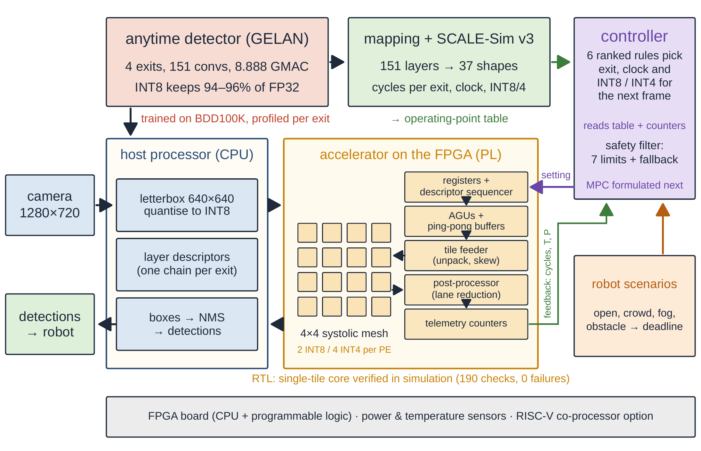

# Feedback-Controlled Safety-Critical AI Accelerator for Autonomous Systems

**M.Tech Project · Department of Computer Science and Engineering · IIT Tirupati**
**Guide:** Dr. Jaynarayan T. Tudu

A robot's camera detector has to answer before the next decision is due, be accurate enough to trust, and stay within the power of a small battery-powered board. One fixed accelerator setting cannot do all three on every stretch of road. This project builds the pieces of an accelerator whose setting (which detector exit answers, the clock, INT8 or INT4) is chosen **every frame by a feedback controller**, with accuracy treated as a hard limit rather than a by-product.



---

## Team and contributions

| Member | Roll No. | Contribution | In this repo |
|---|---|---|---|
| **Abhishek Kumar Maurya** | CS25M201 | Anytime detector: training and profiling | [`anytime-detector-training-and-profiling/`](anytime-detector-training-and-profiling/) |
| **Paidipati Gurudeep** | CS25M111 | Model mapping and execution on the accelerator | [`model-mapping-and-execution/`](model-mapping-and-execution/) · [paper](Model-Mapping-and-Execution.pdf) |
| **C. Rahul** | CS25M207 | Accelerator RTL design and verification | [`reconfigurable-ai-accelerator-design/`](reconfigurable-ai-accelerator-design/) · [report](Reconfigurable_AI_Accelerator_Project_Report.pdf) |
| **Rahul Dewangan** | CS25M114 | Accelerator specification and predictive (MPC) runtime controller | [`mpc-runtime-controller/`](mpc-runtime-controller/) |
| **MD Javid** | CS25M210 | Supervisory runtime controller with safety filter | to be added |

### Abhishek Kumar Maurya: anytime detector
- Designed and trained a **GELAN detector with four exits** from scratch on **BDD100K** (65,000 images). Each exit gives a complete answer: early exits are fast, later ones are sharper.
- Measured every exit: **mAP@0.5 of 0.212 → 0.280 → 0.299 → 0.299** on 1,500 unseen images; INT8 keeps **94–96 %** of FP32 accuracy.
- Built a second, faster **anytime YOLOv8n** (frozen backbone + two light early heads) and compared five models on the same GPU and images.
- Profiled other detectors on BDD100K and KITTI across FP32 / FP16 / INT8, with per-layer weight statistics for quantisation.

### Paidipati Gurudeep: model mapping and execution
- Ran the detector to recover its real workload: **151 convolutions, 8.888 GMAC per frame**, folded into **37 distinct layer shapes**.
- Mapped every layer onto the 4×4 output-stationary INT8/INT4 array and simulated it cycle by cycle in **SCALE-Sim v3** (patched to run large layers).
- Derived a **closed-form cycle equation** that matches SCALE-Sim **exactly on every simulated run**.
- Produced the **operating-point table** the controller chooses from: exit 1 takes **446 ms (INT8) / 233 ms (INT4)** at 200 MHz; exit 4 is never worth choosing (same accuracy as exit 3, slower).

### C. Rahul: RTL design and verification
- Wrote the Verilog for a **descriptor-driven single-tile accelerator**: descriptor sequencer, address generators, ping-pong buffers, tile feeder, **registered 4×4 systolic mesh** and mesh post-processor.
- Each PE does **2 INT8 or 4 INT4 MACs** per cycle with packed signed lanes.
- Built self-checking testbenches stage by stage: **190 checks, 0 failures**; the INT8 4×4 matrix multiply matches a software reference.

### Rahul Dewangan: accelerator specification and MPC controller
- Wrote the accelerator specification: 4×4 output-stationary mesh, INT8/INT4 lanes, 32-word layer descriptor, register map, telemetry counters and implementation phases.
- Built a **model-predictive controller** with three strategies (history-based, frame-preview and within-frame), receding horizon **H = 5** with **beam-search** pruning.
- Generated workload traces from **YOLOv8n on nuScenes** camera frames and evaluated the controllers in a discrete-event **replay harness** at a 33 ms deadline: no deadline misses at quality floors 0.85 and 0.70, and 2 of 80 frames missed by the within-frame controller at 0.45.

### MD Javid: supervisory controller and safety filter
- Built a closed-loop simulation comparing a **fixed setting** with an explainable **six-rule controller**.
- Every proposed setting passes a **safety filter** (7 limits: deadline, accuracy, fps, energy, queue, temperature, battery) with a fallback.
- In a robot scenario (open road, crowd, fog, obstacle) the rule-based controller cut latency by up to **43 %** in hard scenes and power by **70 %** in the open area (modelled).

---

## How the parts connect

1. **Detector** → layer shapes, and accuracy per exit and number format.
2. **Mapping** → cycles and latency per exit, clock and format: the operating-point table.
3. **Specification and RTL** → the hardware that executes it and the counters it reports.
4. **Controllers** → read the table and the counters, and pick the next frame's setting under the latency, accuracy and temperature limits.

## Repository layout

```
.
├── anytime-detector-training-and-profiling/   detector results: accuracy, latency, quantisation, weights
├── model-mapping-and-execution/               SCALE-Sim mapping code, inputs and simulation outputs
├── reconfigurable-ai-accelerator-design/      Verilog RTL, testbenches, waveforms
├── mpc-runtime-controller/                    MPC controllers, replay harness, traces, results
├── Model-Mapping-and-Execution.pdf            paper: model mapping and execution
└── Reconfigurable_AI_Accelerator_Project_Report.pdf   report: RTL design and verification
```

Each folder has its own README with what is inside and how to run it.

## Status

| Done | Next |
|---|---|
| Detector trained and profiled; mapping simulated and checked; single-tile RTL verified; controllers evaluated in simulation | AXI4/DMA and multi-tile RTL, FPGA synthesis, measured latency and power on the board, INT4 accuracy, MPC on the measured table |

Power, temperature and energy figures from the controllers are simulated, not measured on hardware.
