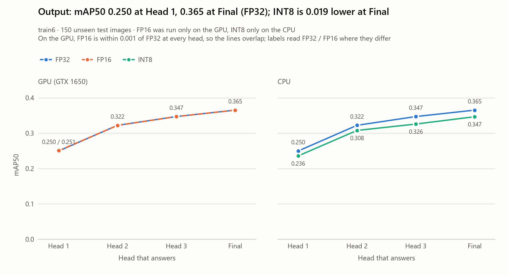
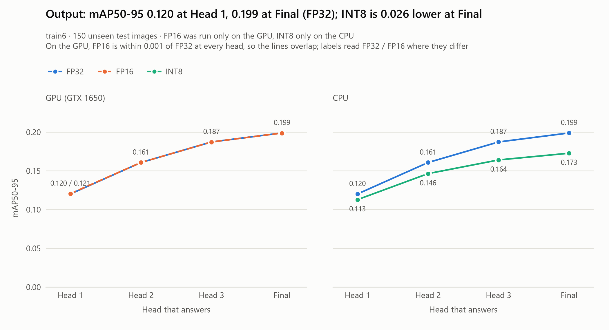
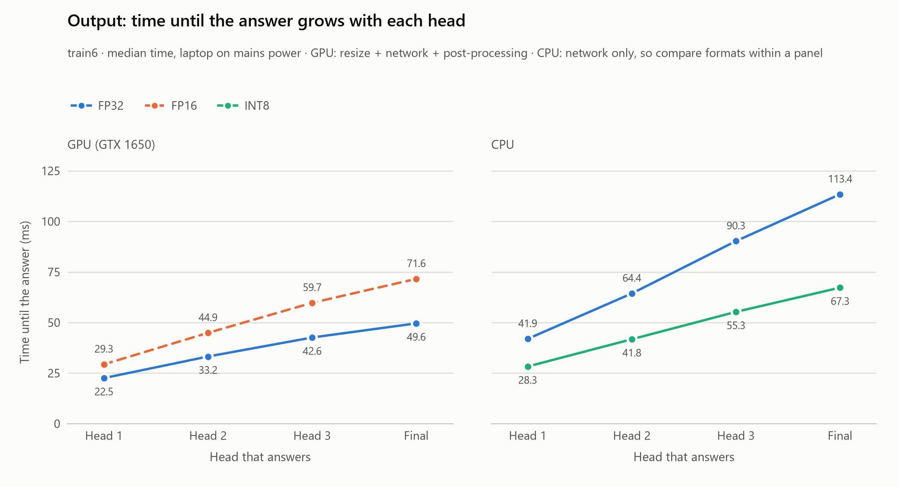
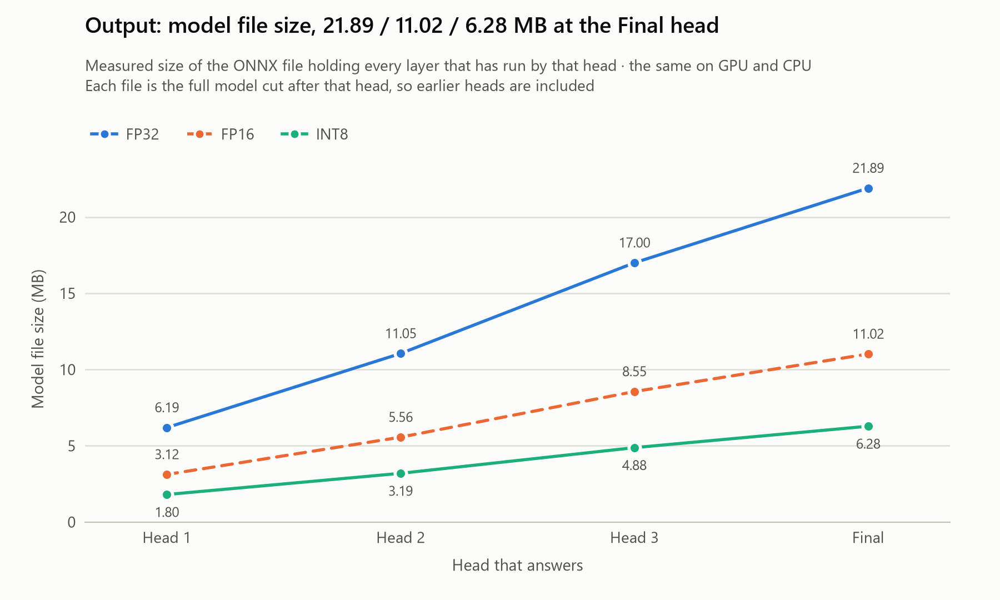
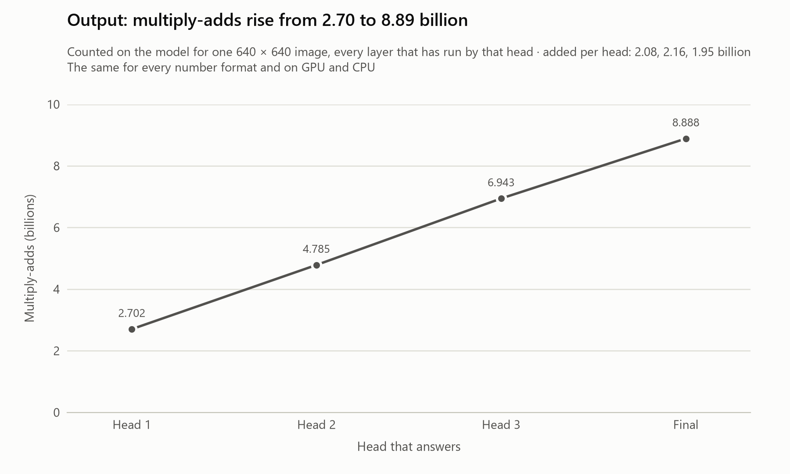

# Parameter study: three inputs, five outputs

This folder holds five graphs. Each one shows how one measured result
(an **output**) changes when three choices (the **inputs**) change.
Every number in the graphs and on this page was measured or counted on
the trained `train6` model; the source file of each one is named below.

| | Parameter | Values |
|---|---|---|
| Input 1 | The head that answers (where an interrupt takes the answer) | Head 1, Head 2, Head 3, Final |
| Input 2 | Number format | FP32 (as trained), FP16, INT8 |
| Input 3 | Hardware | GPU (NVIDIA GTX 1650 laptop), CPU (same laptop) |
| Output 1 | mAP50 (accuracy, box overlap at least 50%) | `params_map50.png` |
| Output 2 | mAP50-95 (stricter accuracy) | `params_map50_95.png` |
| Output 3 | Time until the answer is ready | `params_latency.png` |
| Output 4 | Model file size | `params_file_size.png` |
| Output 5 | Multiply-adds (amount of computation) | `params_compute.png` |

## How to read the graphs

- **x-axis:** the head that answers, in the order the heads finish.
- **Line colour:** the number format. Blue = FP32, orange dashed = FP16,
  green = INT8.
- **Left and right panels:** GPU and CPU. Graphs 4 and 5 have one panel,
  because the hardware does not change them.
- **Labels** next to the points are the measured values.

**Not every combination was run.** FP16 was run only on the GPU, and
INT8 only on the CPU, because INT8 on this GPU would need TensorRT,
which is not installed. So each panel has two lines: GPU = FP32 and
FP16, CPU = FP32 and INT8.

## How the values were measured

| What | Details |
|---|---|
| Model | `runs/anytime_interrupt/train6_bdd70k/last.pt`, no retraining for FP16 or INT8 |
| Test images | First 150 images of the `bdd1500` test split, never used in training |
| INT8 conversion | ONNX Runtime static quantisation: 8-bit weights (per channel) and 8-bit activations, ranges learned with MinMax on 100 calibration images |
| GPU timing | First 60 test images, whole pipeline (resize, network, post-processing), two untimed warm-up passes, median |
| CPU timing | First 60 test images, network only (ONNX Runtime), 15 warm-up runs, three repeats with the versions interleaved, median of the three medians |
| Power | Laptop on mains power for all timing |
| File size | Size on disk of the ONNX file cut after each head |
| Multiply-adds | Counted on the model with hooks on all 151 convolutions, one 640 × 640 image |

## Graph 1: mAP50 (`params_map50.png`)



| Head | FP32 | FP16 (GPU) | INT8 (CPU) | INT8 loss |
|---|---|---|---|---|
| Head 1 | 0.2497 | 0.2506 | 0.2357 | 0.0139 (5.6%) |
| Head 2 | 0.3222 | 0.3220 | 0.3078 | 0.0144 (4.5%) |
| Head 3 | 0.3471 | 0.3469 | 0.3258 | 0.0213 (6.1%) |
| Final | 0.3652 | 0.3651 | 0.3466 | 0.0186 (5.1%) |

FP32 gives the same accuracy on the GPU and the CPU, so it is one row.

- **Each later head is more accurate.** In FP32, Head 1 reaches 68.4% of
  the Final head's mAP50, Head 2 88.2% and Head 3 95.0%.
- **FP16 matches FP32.** The largest difference is 0.0010, at Head 1. On
  the GPU panel the two lines lie on top of each other, so the dashed
  orange line is drawn over the blue one; where the rounded values differ,
  the label shows both (FP32 / FP16).
- **INT8 loses 0.014 to 0.021 mAP50** (4.5% to 6.1%), and the four heads
  keep their order.

## Graph 2: mAP50-95 (`params_map50_95.png`)



| Head | FP32 | FP16 (GPU) | INT8 (CPU) | INT8 loss |
|---|---|---|---|---|
| Head 1 | 0.1202 | 0.1206 | 0.1129 | 0.0073 (6.1%) |
| Head 2 | 0.1608 | 0.1608 | 0.1464 | 0.0143 (8.9%) |
| Head 3 | 0.1873 | 0.1873 | 0.1641 | 0.0232 (12.4%) |
| Final | 0.1990 | 0.1989 | 0.1728 | 0.0261 (13.1%) |

mAP50-95 scores box placement more strictly than mAP50.

- **The same order of heads**, with FP16 again equal to FP32.
- **INT8 loses more here than in Graph 1**, and the loss grows with each
  head: 6.1% at Head 1 to 13.1% at the Final head. INT8 finds about the
  same objects, but places the boxes a little less exactly.

## Graph 3: time until the answer (`params_latency.png`)



| Head | GPU FP32 | GPU FP16 | FP16 ÷ FP32 | CPU FP32 | CPU INT8 | FP32 ÷ INT8 |
|---|---|---|---|---|---|---|
| Head 1 | 22.54 ms | 29.34 ms | 1.30 | 41.93 ms | 28.27 ms | 1.48 |
| Head 2 | 33.21 ms | 44.90 ms | 1.35 | 64.38 ms | 41.75 ms | 1.54 |
| Head 3 | 42.60 ms | 59.74 ms | 1.40 | 90.26 ms | 55.28 ms | 1.63 |
| Final | 49.59 ms | 71.60 ms | 1.44 | 113.42 ms | 67.26 ms | 1.69 |

Values are medians. On the GPU, 90% of frames had the Final answer by
70.3 ms (FP32) and 84.9 ms (FP16).

- **Every later head arrives later**, because the heads run one after
  another; each needs the stage before it.
- **On the GPU, FP16 is slower than FP32**, 1.30× at Head 1 to 1.44× at
  the Final head. A layer-by-layer timing
  (`runs/anytime_interrupt/fp16_layer_timing.json`) puts the loss in the
  convolutions: the 3 × 3 convolutions take 3.9× as long in FP16. The
  GTX 1650 has no fast 16-bit arithmetic.
- **On the CPU, INT8 is faster than FP32**, 1.48× at Head 1 to 1.69× at
  the Final head.
- **Do not compare the two panels with each other.** The GPU times
  include resize and post-processing; the CPU times are the network
  alone.

## Graph 4: model file size (`params_file_size.png`)



| Head | FP32 | FP16 | INT8 |
|---|---|---|---|
| Head 1 | 6.19 MB | 3.12 MB | 1.80 MB |
| Head 2 | 11.05 MB | 5.56 MB | 3.19 MB |
| Head 3 | 17.00 MB | 8.55 MB | 4.88 MB |
| Final | 21.89 MB | 11.02 MB | 6.28 MB |

Each value is the size of the ONNX file holding every layer needed up to
that head. Earlier heads are included, because in an anytime pass they
always run first.

- **FP16 files are about half the FP32 size** (21.89 ÷ 11.02 = 1.99 at
  the Final head).
- **INT8 files are 3.49× smaller than FP32** at the Final head, not 4×,
  because an INT8 file also stores the scale factors and the extra
  quantise and dequantise steps.
- The size is the same whichever hardware runs the file, so this graph
  has one panel.

## Graph 5: multiply-adds (`params_compute.png`)



| Head | Multiply-adds up to this head | Added by this step | Share of the full pass |
|---|---|---|---|
| Head 1 | 2.702 billion | 2.702 billion | 30.4% |
| Head 2 | 4.785 billion | 2.083 billion | 53.8% |
| Head 3 | 6.943 billion | 2.158 billion | 78.1% |
| Final | 8.888 billion | 1.945 billion | 100% |

This is the computation for one 640 × 640 image, counting every
convolution that has run by the time that head answers.

- **The number format does not change it.** FP16 and INT8 do the same
  multiply-adds with smaller numbers.
- **The hardware does not change it either**, so the graph has one line.
- For an accelerator this is the work the multiplier array must do: an
  interrupt that takes Head 1 needs 30.4% of the full computation.

## Files and how to redraw

| File | Contents |
|---|---|
| `params_*.png`, `params_*.svg` | The five graphs (PNG for documents and slides, SVG to scale without blur) |
| `parameter_study.xlsx` | Every measured value at full precision, one sheet per output; differences and ratios are Excel formulas |
| `../make_parameter_study_xlsx.py` | Writes the Excel file from the same data files |
| `../make_result_charts.py` | Draws them (function `chart_parameter_study`) |
| `../../runs/anytime_interrupt/quantization/results.json` | Accuracy (Graphs 1, 2) and GPU timing (Graph 3) |
| `../../runs/anytime_interrupt/quantization/cpu_latency_repeat.json` | CPU timing (Graph 3) |
| `../../runs/anytime_interrupt/model_sizes.json` | File sizes and multiply-adds (Graphs 4, 5) |

To measure again and redraw, run these from the repository's top folder.
`quantize_compare` measures accuracy and GPU timing, and writes the
FP32 and INT8 files. `measure_model_sizes` needs those files.

```bash
.venv\Scripts\python -m anytime_yolo_interrupt.scripts.quantize_compare --checkpoint runs/anytime_interrupt/train6_bdd70k/last.pt --data-root "C:/Users/abhis/Downloads/bdd1500"
```
```bash
.venv\Scripts\python -m anytime_yolo_interrupt.scripts.measure_model_sizes --checkpoint runs/anytime_interrupt/train6_bdd70k/last.pt
```
```bash
.venv\Scripts\python docs/make_result_charts.py
```
```bash
.venv\Scripts\python docs/make_parameter_study_xlsx.py
```

`quantize_compare` also writes a CPU timing, but it is a single run.
Graph 3 uses the three-repeat CPU timing in `cpu_latency_repeat.json`
instead, which was measured with a separate one-off command and has no
script of its own yet.
