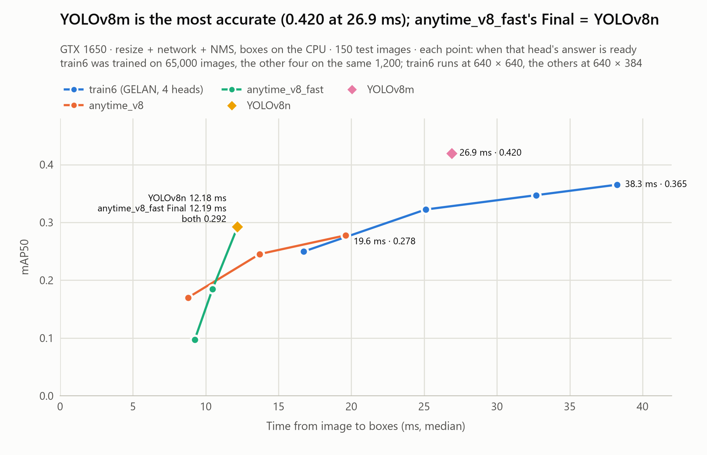
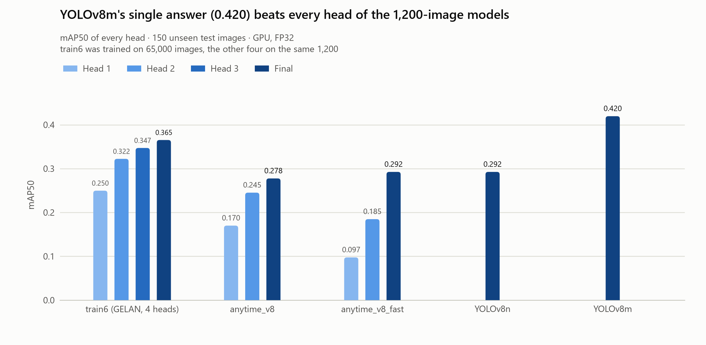
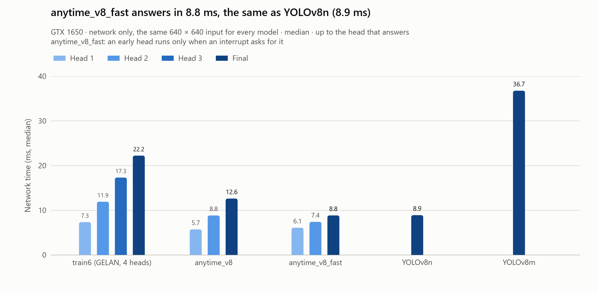
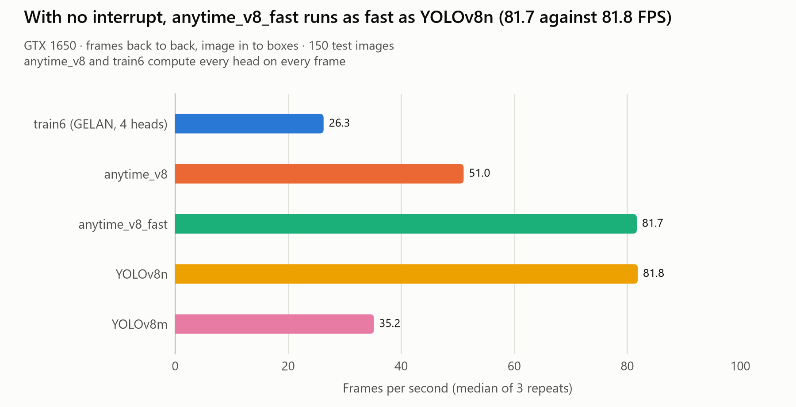
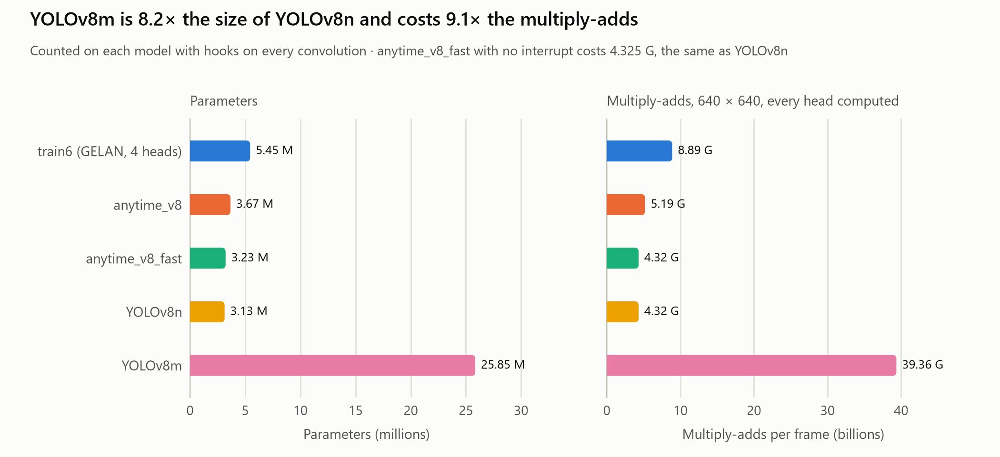
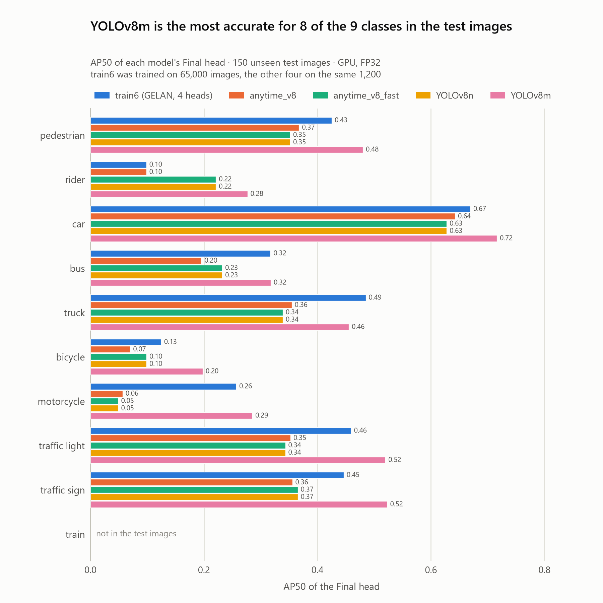
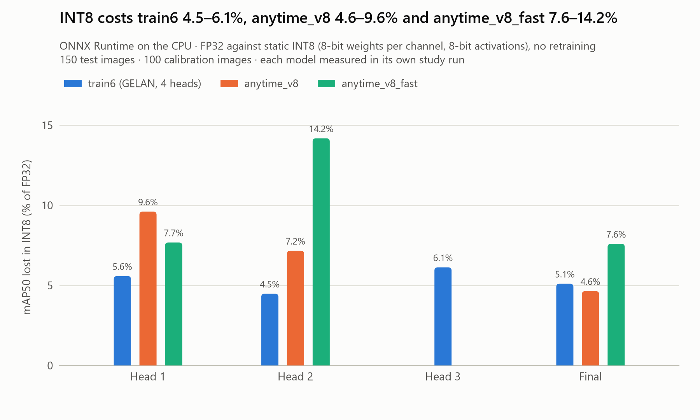
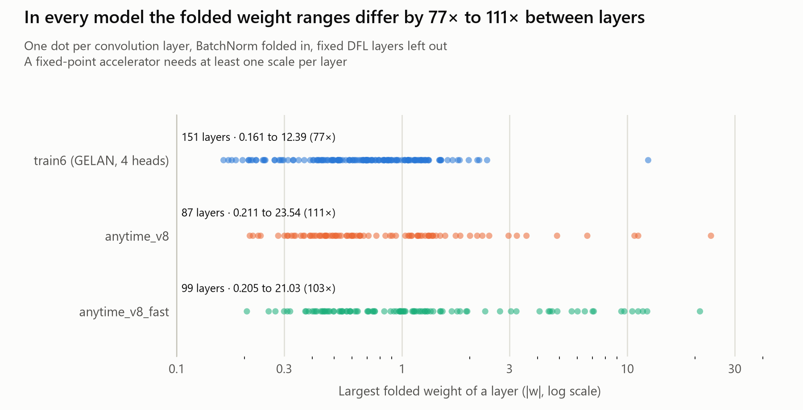

# Comparison of all five models

This folder compares the three anytime models of this project with the
two plain Ultralytics models. All five were measured **in one run**
(`scripts/compare_all_models.py`), on the same GPU and the same test
images. Every number was measured or counted.

| Model | What it is | Checkpoint |
|---|---|---|
| **train6** | GELAN backbone with 4 heads, every head on every frame | `runs/anytime_interrupt/train6_bdd70k/last.pt` |
| **anytime_v8** | YOLOv8n + 2 early heads, trained together, every head on every frame | `runs/anytime_v8/bdd1500/weights/best.pt` |
| **anytime_v8_fast** | Frozen YOLOv8n + 2 depthwise early heads, an early head only on interrupt | `runs/anytime_v8/bdd1500_fast/weights/last.pt` |
| **YOLOv8n** | Ultralytics YOLOv8n, fine-tuned | `runs/yolov8n_compare/bdd1500_ft/weights/best.pt` |
| **YOLOv8m** | Ultralytics YOLOv8m, fine-tuned (50 epochs, batch 4) | `runs/yolov8n_compare/bdd1500_ft_m/weights/best.pt` |

> **Important:** train6 was trained on **65,000 images** (bdd70k). The
> other four were trained on the **same 1,200 images** (bdd1500). So
> train6's higher accuracy comes partly from 54× more data. A fair
> accuracy comparison is between the four bdd1500 models.

## How everything was measured

| What | Details |
|---|---|
| Test images | First 150 images of the `bdd1500` test split, never used in training |
| Accuracy | This project's metric code, confidence ≥ 0.001, NMS IoU 0.7, up to 300 boxes, GPU FP32 |
| GPU | NVIDIA GTX 1650 laptop, mains power |
| Pipeline time | Image in to boxes on the CPU (resize, network, NMS). The models are interleaved frame by frame. train6 runs at 640 × 640 through its own code; the other four at 640 × 384 (letterboxed 1280 × 720 frames), BatchNorm folded |
| Network time | The network alone up to each head, the same 640 × 640 input for every model |
| FPS | Frames back to back with no interrupt, 3 repeats, median |
| Size | Parameters, and multiply-adds counted with hooks on every convolution (640 × 640) |

**Source:** `runs/model_comparison/results.json`. Every value is also in
**`model_comparison.xlsx`** (measured values in blue, formulas in black).

## 1. Time against accuracy (`time_vs_accuracy.png`)



| Model | Head | mAP50 | Time to boxes (ms) |
|---|---|---|---|
| train6 | Head 1 / 2 / 3 / Final | 0.250 / 0.322 / 0.347 / 0.365 | 16.74 / 25.10 / 32.70 / 38.26 |
| anytime_v8 | Head 1 / 2 / Final | 0.170 / 0.245 / 0.278 | 8.79 / 13.70 / 19.61 |
| anytime_v8_fast | Head 1 / 2 / Final | 0.098 / 0.185 / 0.292 | 9.25 / 10.47 / 12.19 |
| YOLOv8n | Final | 0.292 | 12.18 |
| YOLOv8m | Final | 0.420 | 26.89 |

- **The earliest answer** is anytime_v8's Head 1 at 8.79 ms (mAP50 0.170).
- **anytime_v8_fast's Final answer is YOLOv8n**: the same accuracy and
  the same time (12.19 against 12.18 ms).
- **YOLOv8m is the most accurate** (0.420) and needs 26.89 ms, 2.2× the
  time of YOLOv8n.

## 2. Accuracy of every head (`accuracy_by_head.png`, `accuracy_by_head_map50_95.png`)



| Model | Head | mAP50 | mAP50-95 | Precision | Recall |
|---|---|---|---|---|---|
| train6 | Head 1 | 0.2497 | 0.1202 | 0.616 | 0.452 |
| | Head 2 | 0.3222 | 0.1608 | 0.678 | 0.540 |
| | Head 3 | 0.3471 | 0.1873 | 0.686 | 0.546 |
| | Final | 0.3652 | 0.1990 | 0.695 | 0.549 |
| anytime_v8 | Head 1 | 0.1700 | 0.0821 | 0.828 | 0.246 |
| | Head 2 | 0.2452 | 0.1303 | 0.853 | 0.332 |
| | Final | 0.2776 | 0.1478 | 0.884 | 0.330 |
| anytime_v8_fast | Head 1 | 0.0975 | 0.0405 | 0.751 | 0.130 |
| | Head 2 | 0.1847 | 0.0795 | 0.782 | 0.260 |
| | Final | 0.2925 | 0.1619 | 0.862 | 0.326 |
| YOLOv8n | Final | 0.2925 | 0.1619 | 0.862 | 0.326 |
| YOLOv8m | Final | 0.4196 | 0.2327 | 0.863 | 0.475 |

- **YOLOv8m beats every head of every model**, train6 included. It is
  0.127 mAP50 above YOLOv8n with the same training images.
- **Between the two YOLOv8n-based anytime models**: anytime_v8 has much
  better early heads (0.170 and 0.245, against 0.098 and 0.185), but its
  Final head is 0.015 below YOLOv8n. anytime_v8_fast keeps YOLOv8n's
  Final accuracy exactly.
- mAP50-95 gives the same order (second chart).

## 3. Network time (`network_latency.png`)



The network alone, the same 640 × 640 input for every model (ms, median):

| Model | Head 1 | Head 2 | Head 3 | Final |
|---|---|---|---|---|
| train6 | 7.33 | 11.90 | 17.31 | 22.22 |
| anytime_v8 | 5.71 | 8.83 | | 12.61 |
| anytime_v8_fast | 6.09 | 7.39 | | 8.83 |
| YOLOv8n | | | | 8.89 |
| YOLOv8m | | | | 36.75 |

- With the same input size, **YOLOv8m's network takes 4.1× as long as
  YOLOv8n's**.
- YOLOv8m's network time at 640 × 640 (36.75 ms) is longer than its
  pipeline time in section 1 (26.89 ms). This is because the pipeline
  uses the smaller 640 × 384 input.

## 4. Frames per second (`fps.png`)



| Model | FPS (median) |
|---|---|
| train6 | 26.3 |
| anytime_v8 | 51.0 |
| anytime_v8_fast | 81.7 |
| YOLOv8n | 81.8 |
| YOLOv8m | 35.2 |

With no interrupt, anytime_v8_fast runs as fast as YOLOv8n, because it
then runs exactly the YOLOv8n layers.

## 5. Size and computation (`size_and_compute.png`)



| Model | Parameters | Multiply-adds per frame (640 × 640) |
|---|---|---|
| train6 | 5,447,012 | 8.888 billion (all 4 heads) |
| anytime_v8 | 3,666,058 | 5.192 billion (all 3 heads) |
| anytime_v8_fast | 3,225,226 | 4.325 billion (no interrupt) |
| YOLOv8n | 3,134,894 | 4.325 billion |
| YOLOv8m | 25,845,550 | 39.355 billion |

YOLOv8m has 8.2× the parameters of YOLOv8n and needs 9.1× the
multiply-adds. For an accelerator this is the main cost of its higher
accuracy.

## 6. Each class (`per_class_accuracy.png`)



AP50 of each model's Final head:

| Class | train6 | anytime_v8 | anytime_v8_fast | YOLOv8n | YOLOv8m |
|---|---|---|---|---|---|
| pedestrian | 0.426 | 0.368 | 0.352 | 0.352 | **0.481** |
| rider | 0.099 | 0.099 | 0.222 | 0.222 | **0.277** |
| car | 0.670 | 0.643 | 0.628 | 0.628 | **0.717** |
| bus | 0.318 | 0.196 | 0.233 | 0.233 | **0.318** |
| truck | **0.486** | 0.355 | 0.339 | 0.339 | 0.456 |
| bicycle | 0.125 | 0.070 | 0.099 | 0.099 | **0.198** |
| motorcycle | 0.257 | 0.057 | 0.049 | 0.049 | **0.286** |
| traffic light | 0.460 | 0.353 | 0.344 | 0.344 | **0.520** |
| traffic sign | 0.447 | 0.356 | 0.366 | 0.366 | **0.523** |
| train | not in the test images | | | | |

- **YOLOv8m is the best for 8 of the 9 classes.** For bus it is only
  just ahead of train6 (0.3182 against 0.3179). train6 is best for truck.
- **The rare classes gain the most from the bigger model.** Motorcycle
  (39 training boxes) goes from 0.049 with YOLOv8n to 0.286 with YOLOv8m,
  and bicycle from 0.099 to 0.198.

## 7. INT8 accuracy loss (`int8_accuracy_loss.png`)



mAP50 lost when going from FP32 to INT8 on the CPU (ONNX Runtime static
QDQ, no retraining). Each model comes from its own study run:
- train6: `runs/anytime_interrupt/quantization/results.json`
- anytime_v8: `runs/anytime_v8/study_v8/results.json`
- anytime_v8_fast: `runs/anytime_v8/study_fast/results.json`

| Model | Head 1 | Head 2 | Head 3 | Final |
|---|---|---|---|---|
| train6 | 5.6% | 4.5% | 6.1% | 5.1% |
| anytime_v8 | 9.6% | 7.2% | | 4.6% |
| anytime_v8_fast | 7.7% | 14.2% | | 7.6% |

- **anytime_v8_fast loses the most**, up to 14.2% on Head 2. Its
  depthwise early heads have large folded weights (see section 8 and its
  [weight README](../anytime_v8_fast/weight_distribution/README.md)).
- YOLOv8n and YOLOv8m were not quantised in this study.

## 8. Weight ranges (`weight_ranges.png`)



The largest folded weight (BatchNorm folded in) of each convolution
layer, with the fixed DFL layers left out. Data from each model's
`layer_weight_stats.csv`.

| Model | Layers | Smallest | Largest | Spread |
|---|---|---|---|---|
| train6 | 151 | 0.161 (`head1.scale_heads.2.cls_pred`) | 12.39 (`stem.0.conv`) | 77× |
| anytime_v8 | 87 | 0.211 (`model.22.cv3.0.2`) | 23.54 (`model.0.conv`) | 111× |
| anytime_v8_fast | 99 | 0.205 (`model.22.cv3.0.2`) | 21.03 (`model.0.conv`) | 103× |

In every model the first layer has the largest weights. A fixed-point
accelerator therefore needs at least one scale per layer.

## Summary

| If you need… | Best choice here | Why |
|---|---|---|
| The highest accuracy | YOLOv8m | mAP50 0.420, but 26.9 ms and 39.4 G multiply-adds |
| YOLOv8n speed + an early answer on interrupt | anytime_v8_fast | Final = YOLOv8n (0.292, 81.7 FPS); Head 1/2 on interrupt |
| The best early answers on the same data | anytime_v8 | Head 1 0.170 at 8.8 ms, but 51 FPS and Final 0.278 |
| The best anytime accuracy overall | train6 | 0.250 to 0.365, but trained on 54× more data and 26 FPS |

## Regenerate

```bash
.venv\Scripts\python -m anytime_yolo_interrupt.scripts.compare_all_models --data-root "C:/Users/abhis/Downloads/bdd1500"
```
```bash
.venv\Scripts\python docs/make_model_comparison_charts.py
```
```bash
.venv\Scripts\python docs/make_model_comparison_xlsx.py
```
