# Results: fast anytime YOLOv8n

This folder has the same set of results as was made for the earlier model
(`docs/results`, `docs/parameter_study`, `docs/weight_distribution`), for
the **fast anytime model built on YOLOv8n**. Every number was measured or
counted. The file it comes from is named in each section.

| Folder | Contents |
|---|---|
| `results/` | 8 charts (PNG + SVG): accuracy, time, classes, training, number formats, workload |
| `parameter_study/` | 5 graphs (three inputs, five outputs) and `parameter_study.xlsx` with every value |
| `weight_distribution/` | Weight statistics of all 102 layers (CSV), histograms and their [README](weight_distribution/README.md) |

## The model

- **Checkpoint:** `runs/anytime_v8/bdd1500_fast/weights/last.pt`. It was
  trained with `train_anytime_v8 --freeze-base --depthwise`: 50 epochs,
  18 minutes, 1,200 training images.
- **Base:** the fine-tuned YOLOv8n, frozen, so the Final head *is* YOLOv8n.
- **Two early heads**, each with one depthwise 3×3 + 1×1 convolution per
  branch:
  - Head 1 reads layers 4, 6 and 9 (backbone).
  - Head 2 reads layers 15, 12 and 9 (after the FPN).
- **Lazy heads:** an early head is computed only when an interrupt asks
  for it. A frame with no interrupt runs exactly the YOLOv8n pass.
- **Parameters:** 3,225,226. YOLOv8n has 3,134,894 (the two early heads
  add 90,332).

## How everything was measured

| What | Details |
|---|---|
| Test images | First 150 images of the `bdd1500` test split, never used in training. Input 640 × 384 (1280 × 720 frames, letterboxed) |
| Accuracy | This project's metric code, confidence ≥ 0.001, NMS IoU 0.7, up to 300 boxes |
| GPU | NVIDIA GTX 1650 laptop, PyTorch, BatchNorm folded into the convolutions |
| GPU time | Image in to boxes on the CPU (resize, network, NMS), first 60 test images, 2 untimed warm-up passes, median |
| CPU time | Network only, ONNX Runtime, on a graph with exactly the layers that head needs, 60 images, median of 3 interleaved repeats |
| INT8 | ONNX Runtime static QDQ quantisation: 8-bit weights per output channel, 8-bit activations, MinMax ranges from 100 calibration images |
| Power | Mains power for all timing |

**Sources:**
- `runs/anytime_v8/study_fast/results.json`, from `scripts/study_anytime_v8.py`
- `runs/anytime_v8/evaluation_fast.json`, from `scripts/evaluate_anytime_v8.py`. This is the run that compares against YOLOv8n.
- `runs/anytime_v8/evaluation.json`, for the earlier model, whose heads were always computed

## 1. Accuracy of each head (`results/per_head_accuracy.png`)

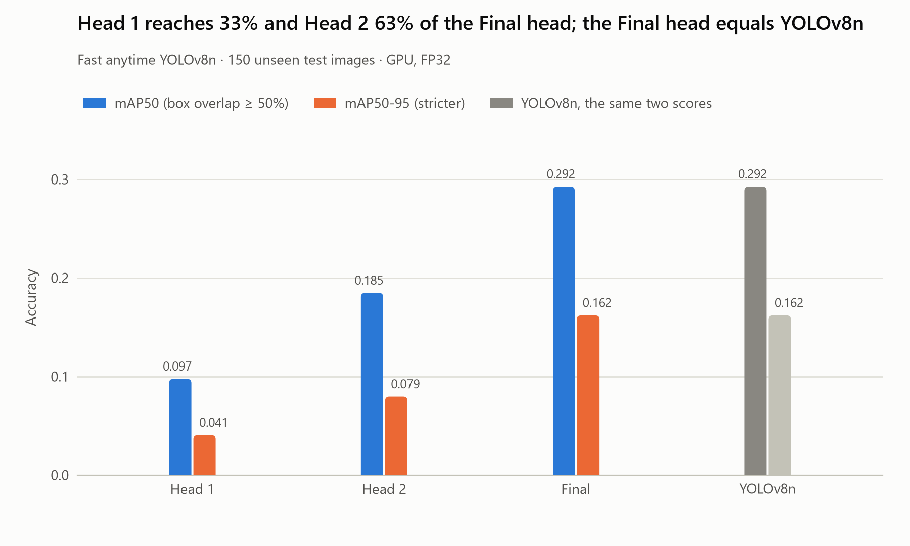

| | Head 1 | Head 2 | Final | YOLOv8n |
|---|---|---|---|---|
| mAP50 | 0.0975 | 0.1847 | 0.2925 | 0.2925 |
| mAP50-95 | 0.0405 | 0.0795 | 0.1619 | 0.1619 |
| Precision | 0.751 | 0.782 | 0.862 | 0.862 |
| Recall | 0.130 | 0.260 | 0.326 | 0.326 |

- **The Final head is exactly YOLOv8n** (identical numbers), because
  YOLOv8n is frozen.
- **Head 1 reaches 33%** and **Head 2 63%** of the Final head's mAP50.
- **The early heads are confident but miss a lot.** Their precision is
  high (0.75 to 0.78), but their recall is low (0.13 and 0.26).

## 2. Time against accuracy (`results/time_vs_accuracy.png`)

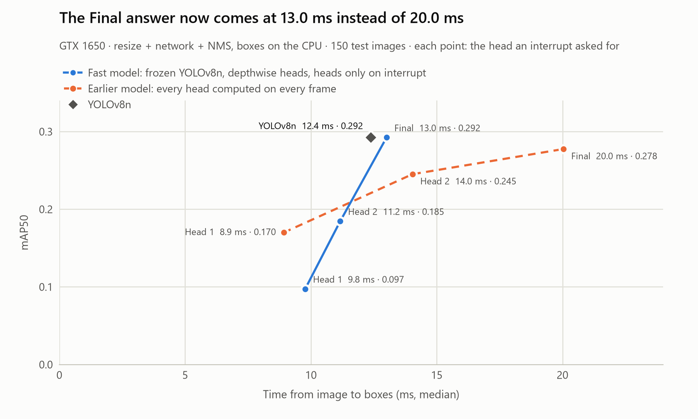

Source: `evaluation_fast.json` (lazy `answer_ms`, YOLOv8n pipeline) and
`evaluation.json` (earlier model, pipeline), 150 images each.

| | Head 1 | Head 2 | Final |
|---|---|---|---|
| Fast model, answer at | 9.77 ms | 11.17 ms | 13.01 ms |
| Earlier model, answer at | 8.92 ms | 14.04 ms | 20.04 ms |
| YOLOv8n | | | 12.38 ms |

- **Head 2 answers 1.2 ms before YOLOv8n.**
- **The Final head comes 0.6 ms after YOLOv8n,** with the same accuracy.
- **Head 1 is 0.85 ms later than before.** It is now computed only after
  the interrupt arrives. From that moment to boxes takes 4.40 ms for
  Head 1 and 4.41 ms for Head 2 (`interrupt_response_ms`).

## 3. Before and after (`results/latency_before_after.png`)

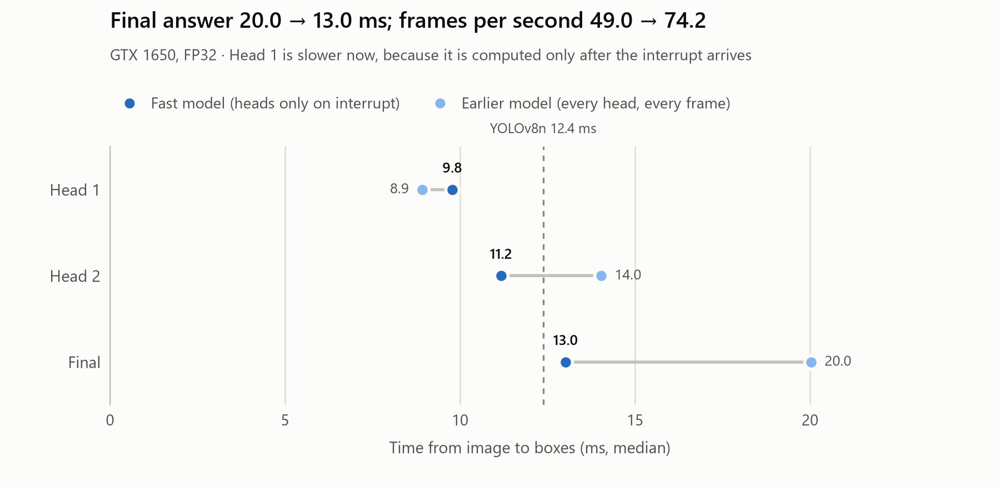

| | Earlier model | Fast model |
|---|---|---|
| Final answer | 20.04 ms | 13.01 ms |
| Frames per second (no interrupt) | 49.0 | 74.2 (YOLOv8n in the same run: 68.4) |

The study run measured the fast model again on 60 images: 75.7 FPS in
FP32 and 46.5 in FP16.

## 4. Each class (`results/per_class_accuracy.png`)

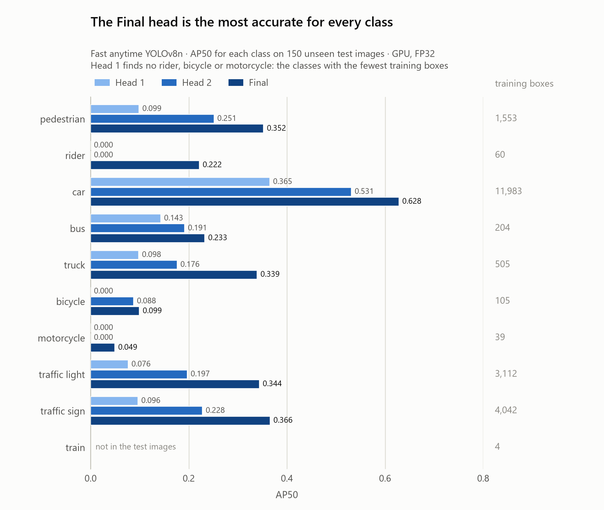

AP50 on GPU, FP32. "Training boxes" is the number of boxes of that class
in the 1,200 training images.

| Class | Head 1 | Head 2 | Final | Training boxes |
|---|---|---|---|---|
| pedestrian | 0.099 | 0.251 | 0.352 | 1,553 |
| rider | 0.000 | 0.000 | 0.222 | 60 |
| car | 0.365 | 0.531 | 0.628 | 11,983 |
| bus | 0.143 | 0.191 | 0.233 | 204 |
| truck | 0.098 | 0.176 | 0.339 | 505 |
| bicycle | 0.000 | 0.088 | 0.099 | 105 |
| motorcycle | 0.000 | 0.000 | 0.049 | 39 |
| traffic light | 0.076 | 0.197 | 0.344 | 3,112 |
| traffic sign | 0.096 | 0.228 | 0.366 | 4,042 |
| train | not in the test images | | | 4 |

- **The Final head is the most accurate for every class.**
- **Head 1 finds no rider, bicycle or motorcycle.** These are the classes
  with the fewest training boxes (except train, which is not in the test
  images).
- **Cars are found best by every head.** They have by far the most
  training boxes.

## 5. Training (`results/learning_curves.png`)

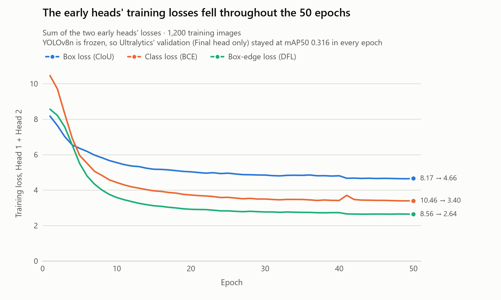

Source: `runs/anytime_v8/bdd1500_fast/results.csv`. The curves are the
sum of the two early heads' losses.

| Loss | Epoch 1 | Epoch 50 |
|---|---|---|
| Box (CIoU) | 8.17 | 4.66 |
| Class (BCE) | 10.46 | 3.40 |
| Box edge (DFL) | 8.56 | 2.64 |

**Validation during training cannot show the early heads.** Ultralytics
checks only the Final head, which is frozen, so it stayed at mAP50 0.316
on the 150 calibration images in every epoch. That is why there is no
validation curve per head, and why `last.pt` (epoch 50) is used.

## 6. Number formats: accuracy (`results/quantization_accuracy.png`)

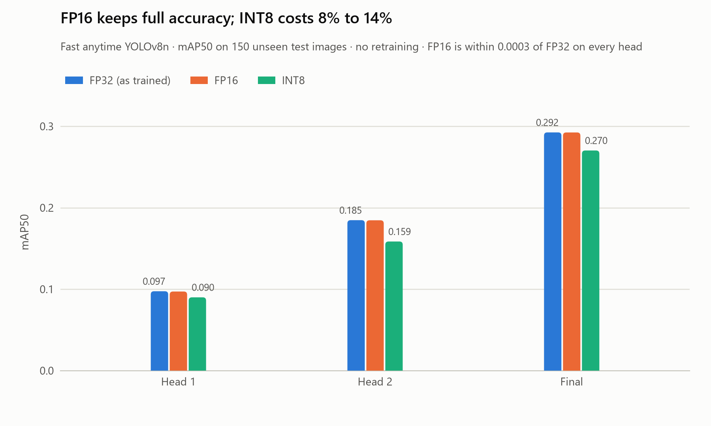

| mAP50 | GPU FP32 | GPU FP16 | CPU FP32 | CPU INT8 | INT8 loss |
|---|---|---|---|---|---|
| Head 1 | 0.0975 | 0.0971 | 0.0975 | 0.0900 | 7.7% |
| Head 2 | 0.1847 | 0.1846 | 0.1847 | 0.1585 | 14.2% |
| Final | 0.2925 | 0.2924 | 0.2925 | 0.2703 | 7.6% |

| mAP50-95 | GPU FP32 | GPU FP16 | CPU FP32 | CPU INT8 |
|---|---|---|---|---|
| Head 1 | 0.0405 | 0.0405 | 0.0405 | 0.0361 |
| Head 2 | 0.0795 | 0.0804 | 0.0795 | 0.0689 |
| Final | 0.1619 | 0.1616 | 0.1619 | 0.1509 |

- **FP16 keeps full accuracy:** it is within 0.0004 mAP50 of FP32 on
  every head.
- **INT8 costs 8 to 14% mAP50**, with no retraining. For the earlier
  train6 model it cost 4.5 to 6.1%. Head 2 loses the most.
- **FP32 on the CPU (ONNX) gives the same accuracy as FP32 on the GPU.**
  This shows the exported graphs are correct.

## 7. Number formats: time (`results/quantization_latency.png`)

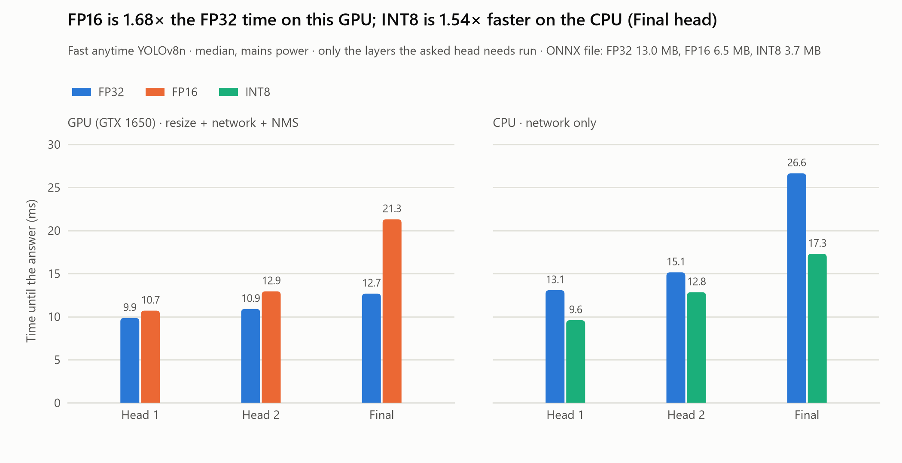

| Median (ms) | GPU FP32 | GPU FP16 | CPU FP32 | CPU INT8 |
|---|---|---|---|---|
| Head 1 | 9.85 | 10.70 | 13.07 | 9.59 |
| Head 2 | 10.89 | 12.94 | 15.15 | 12.84 |
| Final | 12.68 | 21.31 | 26.65 | 17.30 |

- **FP16 is slower on this GPU:** 1.68× the FP32 time for the Final head.
  The GTX 1650 has no Tensor Cores (the same finding as for train6).
- **INT8 is 1.54× faster on the CPU** for the Final head.
- GPU times include resize and NMS, but CPU times are the network only.
  So compare formats within one device, not GPU with CPU.

## 8. Computation by stage (`results/workload_by_stage.png`)

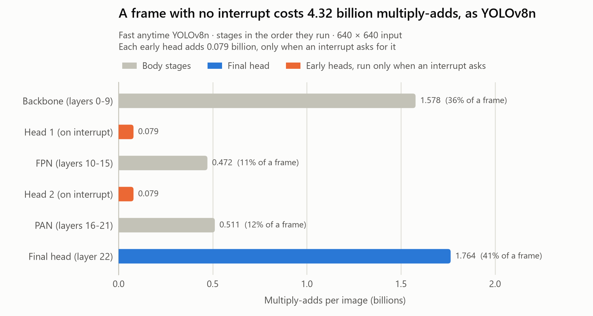

Multiply-adds for one 640 × 640 image, counted with hooks on every
convolution.

| Stage | Multiply-adds | Share of a frame with no interrupt | Parameters |
|---|---|---|---|
| Backbone (layers 0-9) | 1,577,779,200 | 36.5% | 1,270,144 |
| Head 1 (only on interrupt) | 79,206,400 | | 45,166 |
| FPN (layers 10-15) | 471,859,200 | 10.9% | 184,896 |
| Head 2 (only on interrupt) | 79,206,400 | | 45,166 |
| PAN (layers 16-21) | 511,180,800 | 11.8% | 800,064 |
| Final head (layer 22) | 1,764,134,400 | 40.8% | 879,790 |

- **A frame with no interrupt costs 4.325 billion multiply-adds**, the
  same as YOLOv8n.
- **Each early head adds 0.079 billion**, and only when it is asked for.
  The earlier model's early heads cost 0.433 billion each, and they ran
  on every frame.

## 9. Parameter study: three inputs, five outputs (`parameter_study/`)

The same layout as `docs/parameter_study`. The three inputs are:
- **The head that answers** (x-axis)
- **The number format** (line colour: blue FP32, dashed orange FP16, green INT8)
- **The hardware** (left panel GPU, right panel CPU)

FP16 was run only on the GPU and INT8 only on the CPU. INT8 on this GPU
needs TensorRT, which is not installed.

| Output | Graph | Values |
|---|---|---|
| mAP50 | 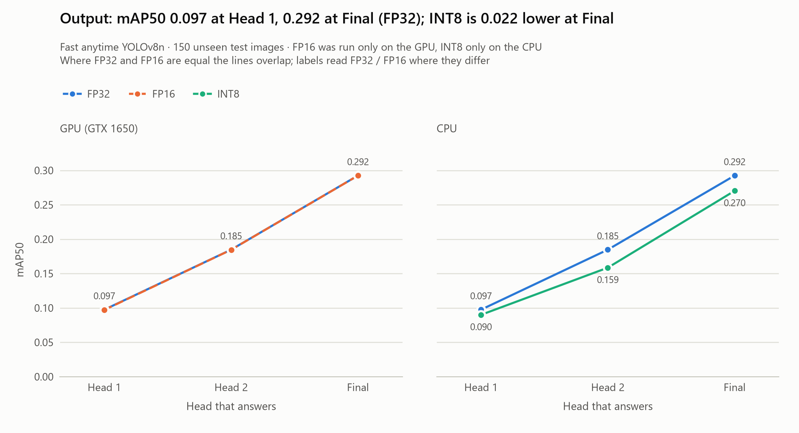 | Section 6 |
| mAP50-95 | 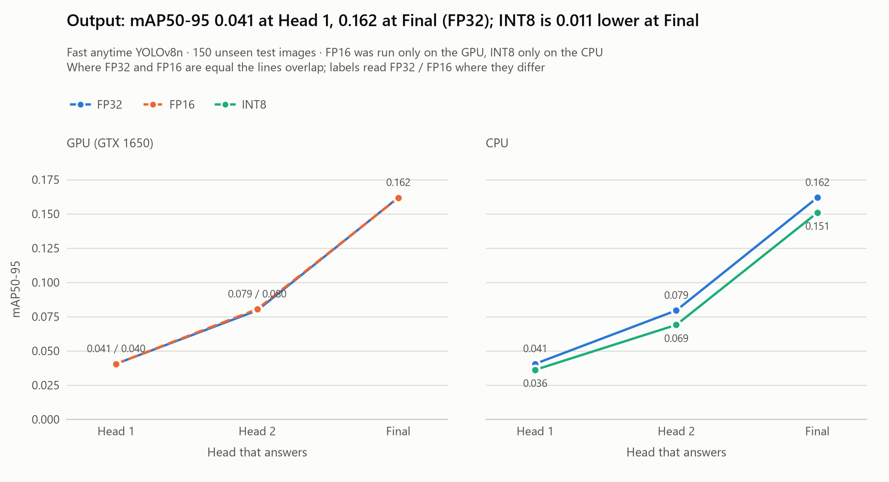 | Section 6 |
| Time until the answer | 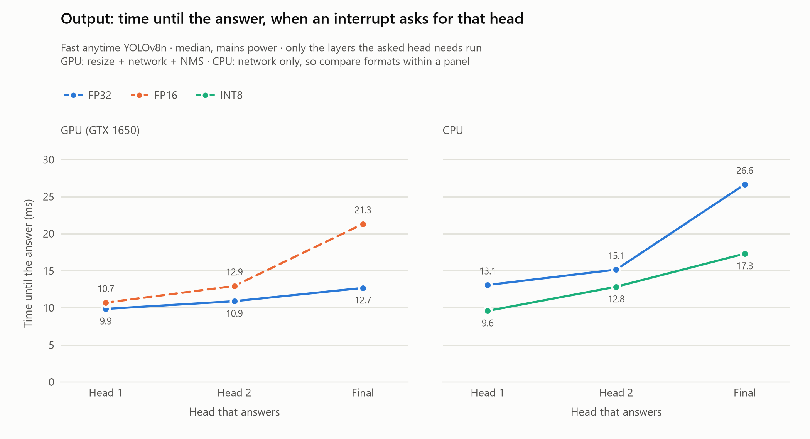 | Section 7 |
| Model file size | 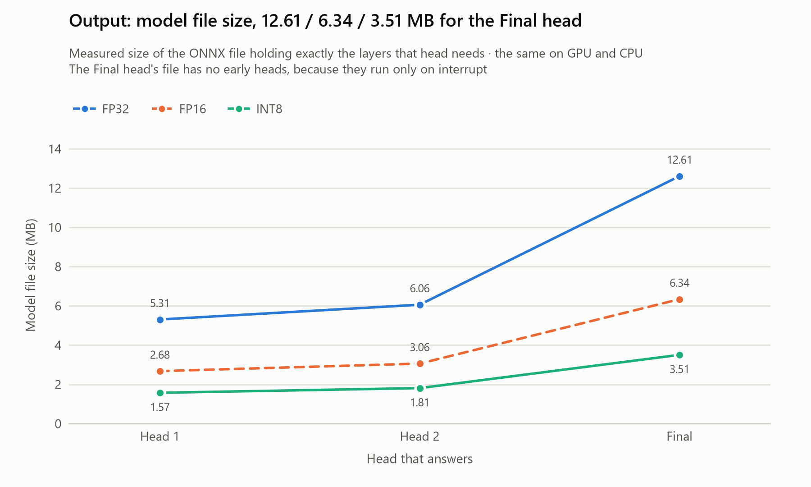 | Below |
| Multiply-adds | 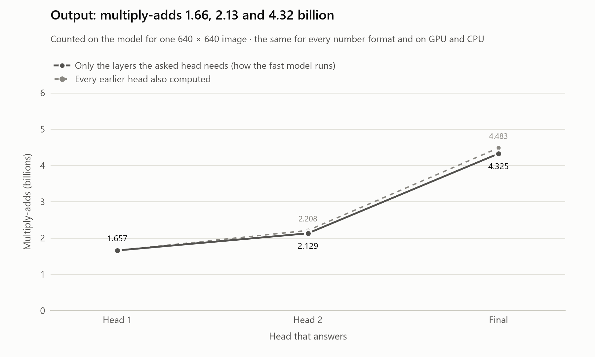 | Below |

**File size**, measured on disk. Each ONNX file holds exactly the layers
that head needs. The Final head's file has no early heads, because they
run only on interrupt.

| MB | FP32 | FP16 | INT8 |
|---|---|---|---|
| Head 1 | 5.309 | 2.678 | 1.574 |
| Head 2 | 6.062 | 3.061 | 1.813 |
| Final | 12.612 | 6.342 | 3.506 |
| Whole model (all heads) | 12.973 | 6.522 | 3.714 |

The PyTorch state_dict is 13.13 MB in FP32 and 6.62 MB in FP16. The
checkpoint file `last.pt` is 6.75 MB, because Ultralytics stores it in
FP16.

**Multiply-adds up to each answer:**

| | Only the layers that head needs (how the fast model runs) | Every earlier head also computed |
|---|---|---|
| Head 1 | 1.657 billion | 1.657 billion |
| Head 2 | 2.129 billion | 2.208 billion |
| Final | 4.325 billion | 4.483 billion |

**`parameter_study/parameter_study.xlsx`** holds every value above.
Measured values are in blue, copied at full precision; differences, ratios
and shares are Excel formulas in black. Its sheets are:
- Read me
- mAP50 and mAP50-95 (with YOLOv8n)
- Per-class AP50 (FP32 and INT8)
- Latency (with frames per second, the interrupt response and the earlier model)
- File size
- Multiply-adds

## 10. Weight distribution (`weight_distribution/`)

Statistics and 64-bin histograms of all 102 convolution layers, as trained
and with BatchNorm folded in. See its
[README](weight_distribution/README.md). In short:
- **The YOLOv8n layers are bit-for-bit those of the fine-tuned YOLOv8n.**
- **The depthwise early-head layers have folded weights up to 12.3.**
- **Folded ranges differ by about 103×** between layers.

## Regenerate

```bash
.venv\Scripts\python -m anytime_yolo_interrupt.scripts.study_anytime_v8 --checkpoint runs/anytime_v8/bdd1500_fast/weights/last.pt --data-root "C:/Users/abhis/Downloads/bdd1500"
```
```bash
.venv\Scripts\python docs/make_anytime_v8_fast_charts.py
```
```bash
.venv\Scripts\python docs/make_anytime_v8_fast_xlsx.py
```
The weight files are regenerated with the commands in
[weight_distribution/README.md](weight_distribution/README.md).
