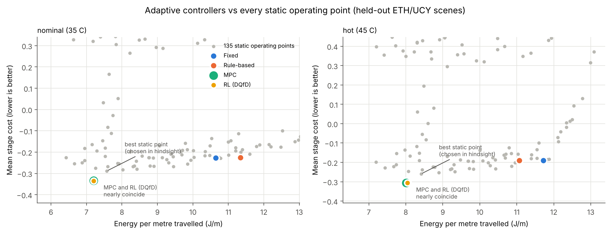
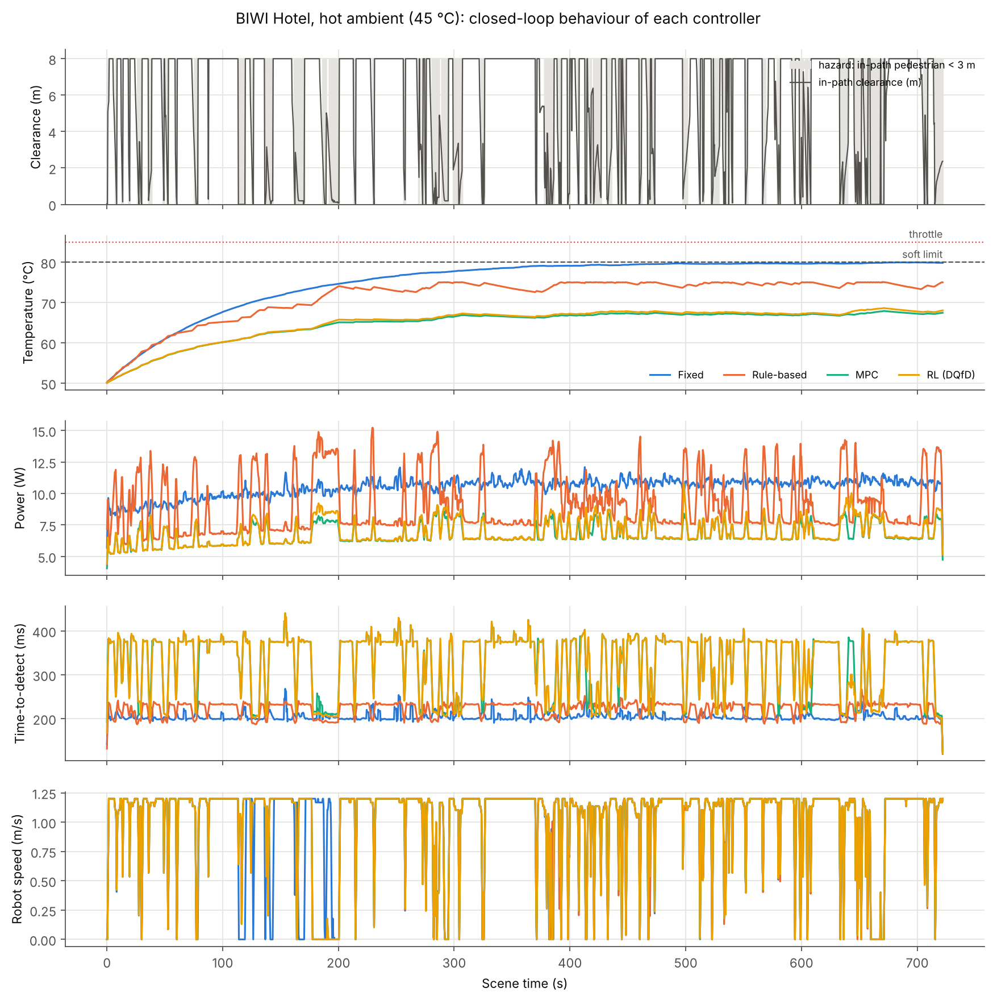

# Safety-Shielded Run-Time Control of an Edge AI Accelerator for a Crowd-Navigating Robot

A closed-loop research testbed and four controllers (Fixed, Rule-based, MPC, RL) that
choose the accelerator's **operating point**: DVFS frequency × numeric precision ×
structured sparsity × **Anytime-YOLO exit**. The controller runs the perception for a
mobile robot that is replayed through **all real pedestrian crowds of the ETH/UCY
benchmark**. The core question:

> How should the perception accelerator be reconfigured at run time so that the robot
> stays safe around people while spending as little energy and heat as possible?

The coupling that makes this a *safety* problem, not only an efficiency problem: the robot
may only drive as fast as it can still stop for the nearest pedestrian. Its stopping
distance includes the perception pipeline's **time-to-detect**, which depends on latency,
queueing, throughput and the detector's recall (that is, on the operating point).

## Headline results (held-out ETH/UCY scenes, 18 episodes per controller per condition)

| Controller | Cost ↓ (35 °C / 45 °C) | Energy vs Fixed (paired, 95% CI) | Max temp at 45 °C | Perception-induced violations | Decision time |
|---|---|---|---|---|---|
| Fixed (v1 default f3/FP16/20%/full) | −0.228 / −0.190 | — | 80.0 °C (pinned at the soft limit; shield overrides 7% of steps) | 0.16 /km | — |
| Rule-based | −0.225 / −0.190 | **+13.9%** [+5.1, +22.6] at 35 °C | 75.2 °C | 0.00 /km | <0.01 ms |
| **MPC** (8-step horizon + thermal tail) | **−0.334 / −0.306** | **−29.5%** [−32.6, −26.4] | 71.1 °C | 0.16 /km | ~13 ms |
| **RL (DQfD, shielded)** | **−0.336 / −0.305** | **−29.4%** [−32.5, −26.4] | 71.1 °C | 0.16 /km | **0.04 ms** (+1 ms shield) |

* MPC and the RL agent beat **every one of the 135 static operating points**, including the
  best static point chosen in hindsight on the test scenes (cost −0.288 / −0.259).
* They adapt as intended: drop to `f1/INT8/sp0.4/head1` (early exit) in open space,
  and switch to the full network with more throughput when a pedestrian enters the path
  (see `results/plots/knob_usage_hotel_hot.png`). The price is a 2% longer
  time-to-detect during hazards, kept within the shield's bounds.
* The **DQfD agent matches MPC on every held-out scene**: its network decides in 0.04 ms against MPC's ~13 ms
  (about 1.2 ms per step including the shield check, so roughly 10× cheaper end to end).
  RL from scratch (same network and budget) is *worse than Fixed*, and the agent without the
  shield's action mask misses ~9.5% of deadlines. Both ablations are in `results/RESULTS.md`.
* Without the shield, 20 of the 135 static points hit the hardware thermal throttle in the
  45 °C condition; `f5/FP32` is throttled for 1,186 s across the six scenes. With the shield, no
  controller is ever throttled.

Full tables (per scene, synthetic stress scene, ablations, best static point): **`results/RESULTS.md`**.




---

## Pipeline

Each box maps 1:1 to code.

```mermaid
flowchart LR
  subgraph S[Scenario sources]
    D[ETH/UCY trajectories<br/>8 sequences, 2,205 people] --> N
    E[Equation-based crowd generator<br/>4 phases, Poisson arrivals] --> N
    C[Any trajectory CSV<br/>frame,ped_id,x,y] --> N
  end
  N[Scenario normalisation<br/>robot/scenes.py] --> P[Robot perception features<br/>clearance, density, hazard, CV forecast<br/>robot/safety.py]
  P --> K{Controller<br/>Fixed / Rule / MPC / RL}
  K --> SH[Safety & feasibility shield<br/>C1-C5, Simplex backup<br/>control/shield.py]
  SH --> A[Accelerator plant<br/>latency, recall, power, leakage,<br/>RC thermal, queue, throttle<br/>accel/model.py]
  A --> R[Robot speed constraint<br/>v·(t_detect+t_act)+v²/2a ≤ d_free<br/>sim/env.py]
  R -->|telemetry| P
  R --> M[Metrics -> tables & plots<br/>experiments/]
```

| Pipeline step | Where |
|---|---|
| 1 Problem definition (latency, energy, accuracy, thermal, safety) | `config/params.py` (`CostWeights`, limits), `sim/env.py::stage_cost` |
| 3 Workload & scenario design (equation-based + CSV datasets) | `robot/scenes.py` |
| 4 System modelling (latency, power, energy, accuracy, thermal, queue) | `accel/model.py` |
| 5 Accelerator state & configuration (freq, precision, sparsity, exit) | `accel/model.py::ActionSpace` (135 points) |
| 6 Controller decision layer (Fixed, Rule, MPC, RL) | `control/baselines.py`, `control/mpc.py`, `control/dqn.py` |
| 7 Safety & feasibility layer | `control/shield.py` |
| 8–9 Simulation environment and telemetry feedback | `sim/env.py`, `sim/runner.py` |
| 10–12 Scenario-based evaluation, comparison, plots | `experiments/evaluate.py`, `experiments/report.py` |

## Problem formulation

**Action** `a = (f, p, s, e)`, with f ∈ 5 DVFS levels (0.31–1.12 GHz), p ∈ {FP32, FP16, INT8},
s ∈ {0, 0.2, 0.4} structured sparsity, e ∈ {head1, head2, final} Anytime-YOLO exits. That gives 135 points.

**Latency** (anchored to measurements):
`L(a) = L_net(e) · k_edge · (f_max/f) · κ_p(p) · κ_s(s) + L_host(e) + c_nms·n_objects`
* `L_net(e)` and `L_host(e)`: measured Anytime-YOLO network and pre/post-processing medians (GTX 1650, BDD100K).
* `κ_p`: derived from YOLO11n TensorRT T4 measurements (FP16 0.87, INT8 0.65 of FP32 network time).
* Realised latency: lognormal jitter whose σ is fitted to each exit's **measured p90**, plus rare
  contention spikes (2%, ×1.8). Reconfiguration costs 1 ms for a DVFS step and 12 ms for an engine
  swap (precision or sparsity change); changing the exit is free.

**Detection quality:** mAP@50 and recall per exit are measured. The INT8 factor 0.943 comes
from the YOLO11n measurement. Crowd occlusion lowers recall by up to 30%.

**Power and thermal:** `P = P_idle + u·P_dyn·(f/f_max)(V/V_max)²·π_p·π_s + P_leak0·e^{β(T−25)}`,
where `u` is the busy fraction and `π_p` the measured T4 board-power ratios. The thermal model
is a first-order RC (R = 3.2 °C/W, τ = 80 s) with exact discretisation. The hardware throttles
to f_min at 85 °C; the soft limit is 80 °C.

**Queue:** a 30 FPS camera with a bounded 4-frame queue; frames beyond that are dropped.

**Time-to-detect** of a newly appearing pedestrian (tracker needs `h = 2` hits):
`t_detect = L + queue wait + (h / recall − 1) / FPS_processed`.
So a fast early exit with low recall, or a slow point whose FPS falls below the camera rate,
both *increase* t_detect.

**Robot speed constraint:**
`v_permit = min(v_nom, v_zone, v_crowd(ρ), v_stop)`, with `v_stop = −aτ + √((aτ)² + 2a·d_free)` and
`τ = t_detect + t_act`. The planner uses the operating point's **p90 contract**. A step is a
*perception-induced violation* when the commanded speed exceeds what the *realised*
t_detect permits by more than 0.05 m/s. Pedestrians cutting in closer than the robot can
brake for are logged separately (`braking_limited_conflicts`), because the crowd causes them, not the controller.

**Objective** (shared by MPC, RL and the report):
`cost = −progress + 0.04·P + 20·P(miss | hazard) + 10·violation + 2·deadline_miss + 0.4·[T−80]⁺ + 5·throttled + 0.05·switch + 0.5·drop_frac`

## Controllers

| | How it decides |
|---|---|
| **Fixed** | v1 default `f3/FP16/sp0.2/final`, always. |
| **Rule-based** | v1 rules extended with the exit and robot cues: thermal protection > imminent hazard > forecast hazard or dense crowd > moderate > eco. |
| **MPC** | Exhaustive, vectorised receding-horizon search. Uses two-block move blocking (a1 now, a2 held for the remaining 7 steps); a1 is limited to shield-admissible points and a2 to the 65 Pareto-efficient points. Crowd forecast is constant-velocity extrapolation of tracked pedestrians. Expected deadline misses are computed in closed form, and a 60 s coarse thermal tail prices heat beyond the horizon. |
| **RL (DQfD)** | Double DQN with a **branching-dueling head**: a factored advantage per knob plus a joint advantage (after BDQ, Tavakoli et al. 2018), 3-step returns, and **action masking by the shield** (a preemptive shield, after Alshiekh et al. 2018). It is pre-trained on MPC demonstrations with the DQfD large-margin loss (Hester et al. 2018) and then fine-tuned online with domain randomisation (ambient 30–48 °C, initial 40–72 °C). The best checkpoint is chosen on validation windows from training scenes. Pure NumPy, no deep-learning framework. |

**Shield** (applies to every controller): C1 p90 latency plus reconfiguration overhead ≤ 50 ms; C2 the next step stays
≤ 80 °C and holding the point for 4 s stays below the throttle point; and when a pedestrian is in the hazard
zone, C3 P(miss) ≤ 5%, C4 no frame drops, and C5 a latency spike must not cut the permitted speed by more than
0.05 m/s. An inadmissible proposal is replaced by the nearest admissible point in knob space. If nothing is
admissible, a Simplex-style backup is used.

## Data and protocol

* **ETH/UCY**, all 8 sequences: BIWI ETH, BIWI Hotel, UCY Univ (students001/003), Zara01/02/03 and
  uni_examples. That's 2,205 pedestrians and 7,403 time steps at 2.5 Hz, about 49 minutes of real crowds. The
  raw files are in `data/eth_ucy/` (from the Trajectron++ repository).
* The robot drives back and forth along the dominant flow axis of each scene (5th–95th percentile
  extent), so it spends most of its time in counter-flow.
* **Leave-one-scene-out** (the standard ETH/UCY protocol): 5 folds (eth, hotel, univ, zara1, zara2). Each RL
  agent is trained only on the other folds, plus zara03 and uni_examples (training-only), plus two
  synthetic scenes. The MPC demonstrations used for DQfD come from the same training scenes only.
* Evaluation: the 6 test sequences × 2 ambient conditions (35 °C, 45 °C) × 3 latency-jitter seeds,
  plus one synthetic equation-based stress scene that no agent saw. Every frame of every test sequence is replayed.
* Statistics: pooled step-weighted metrics; improvements vs Fixed are paired per episode with
  bootstrap 95% CIs.

## Reproduce

```bash
python -m venv .venv && source .venv/bin/activate   # Windows: .\.venv\Scripts\Activate.ps1
pip install -r requirements.txt                     # numpy + matplotlib only
python -m unittest discover -s tests -v             # 14 tests (~3 s)

python main.py demo --sequence crowds_zara01 --ambient 45   # all controllers on one scene (~15 s)
python main.py report                                       # rebuild tables and plots from results/
python main.py all --workers 2                              # full pipeline, from scratch
```

Runtime of the full pipeline on a 2-core CPU:

| Step | Time |
|---|---|
| MPC demonstrations | ~3.5 min |
| 5 DQfD folds × 60k steps | ~13 min |
| 5 from-scratch DQN folds × 100k steps (ablation) | ~16 min |
| Evaluation: 228 episodes plus 1,620-episode static sweep | ~10 min |

The trained agents ship in `models/`, so `evaluate` and `report` work without retraining.
Individual steps:

```bash
python -m experiments.train_rl --kind dqfd --steps 60000 --workers 2
python -m experiments.train_rl --kind dqn  --steps 100000 --workers 2   # ablation
python -m experiments.evaluate --seeds 0 1 2 --workers 2
python -m experiments.report
```

To use another robot dataset (CrowdBot, JRDB, SCAND, …), export the pedestrian tracks as a CSV
with `frame,ped_id,x,y` in metres and load it with `robot.scenes.load_trajectory_file(path, dt)`.

## Repository layout

```
config/params.py       every parameter, tagged [measured] / [derived] / [assumption]
accel/model.py         vectorised accelerator model + 135-point action space
accel/anytime_yolo_profiles.json   measured Anytime-YOLO exit profiles
robot/scenes.py        ETH/UCY + CSV loaders, equation-based crowd generator, robot path
robot/safety.py        perception features, time-to-detect speed constraint
sim/env.py             closed-loop environment and shared stage cost
sim/runner.py          episode loop and metrics
control/               baselines.py, shield.py, mpc.py, dqn.py
experiments/           common.py, train_rl.py, evaluate.py, report.py
models/                trained agents (dqfd_*, dqn_*), MPC demos, training log
results/               RESULTS.md, summary.csv, per_episode.csv, static_sweep.csv, timeseries/, plots/
tests/test_core.py     model anchors, physics invariants, gradient check, closed-loop checks
```

## What changed from v1

* **Removed** (redundant or unused): `hardware/` adapter, base and systolic layers; `state/` telemetry,
  estimator and state manager; `experiments/metrics.py` and `runner.py` (never called); the separate latency,
  energy, thermal, accuracy and workload model files (merged into one vectorised model);
  `run_anytime_yolo_profiles.py`; `visualization/`; the 3-row template CSV; stale results. That's about 5,300 lines down to about 2,070.
* **Fixed**: v1's `mpc.py` and `rl_agent.py` could not be constructed (`BaseController.__init__()`
  missing `name`) and had a different method signature. Both were rewritten.
* **Made the problem non-trivial**: in v1 every controller ran at ~3 ms and 39 °C, so no constraint was
  ever active. The model is now anchored to the measured profiles, and thermal, queue and deadline constraints actually bind.
* **New**: real-crowd replay over the full ETH/UCY benchmark, latency-aware robot safety, the anytime-exit
  knob, the run-time shield, MPC, DQfD/DQN agents, ablations, the static sweep, and paired statistics.

## Assumptions and limitations (read before citing numbers)

* **Simulation, not hardware.** Latency, mAP and recall are anchored to measurements: Anytime-YOLO on a
  GTX 1650, and YOLO11n FP32/FP16/INT8 on a T4. Power, leakage, thermal RC, DVFS ladder, sparsity effects,
  edge slowdown (1.5×), spikes and reconfiguration costs are documented assumptions in `config/params.py`.
  The next step is to calibrate them on a Jetson (tegrastats power and temperature) and re-run.
* **Non-reactive replay.** ETH/UCY pedestrians do not react to the robot. In dense UCY scenes the robot
  "freezes" (students001: about 60% of the time stopped), which is why perception choices change progress
  only a little. Frontal contacts are reported but not optimised.
* Recall is BDD100K all-class recall, used as a per-frame detection probability that is independent across frames.
* MPC and RL optimise the same cost the report uses. Different weights move the trade-off; all weights are in one place.
* The violation counts are small in absolute terms (2 events in about 12 km of driving per controller with the
  shield, versus 1.96/km for unshielded Fixed in the seed-0 ablation), so read them as "the shield removes most of them", not as precise rates.

## References

* Pellegrini et al., *You'll Never Walk Alone*, ICCV 2009 (ETH); Lerner et al., *Crowds by Example*, 2007 (UCY).
* Salzmann et al., *Trajectron++*, ECCV 2020 (source of the processed ETH/UCY files).
* Alshiekh et al., *Safe Reinforcement Learning via Shielding*, AAAI 2018.
* Hester et al., *Deep Q-learning from Demonstrations*, AAAI 2018.
* Tavakoli et al., *Action Branching Architectures for Deep RL*, AAAI 2018.
* van Hasselt et al., *Double Q-learning*, AAAI 2016; Wang et al., *Dueling Network Architectures*, ICML 2016.
* Sha, *Using Simplicity to Control Complexity* (Simplex architecture), IEEE Software 2001.
